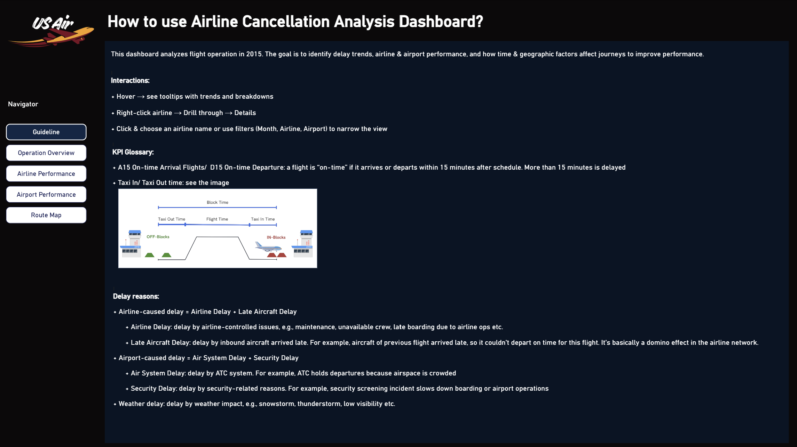
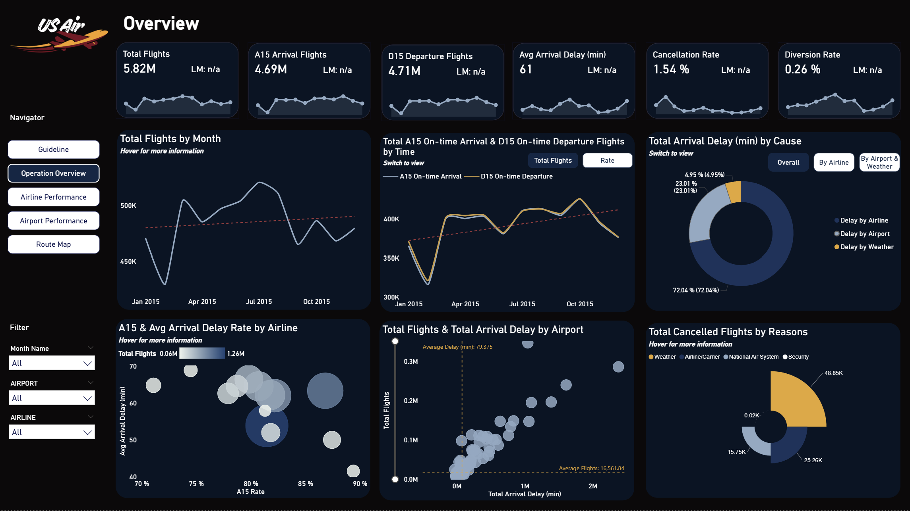
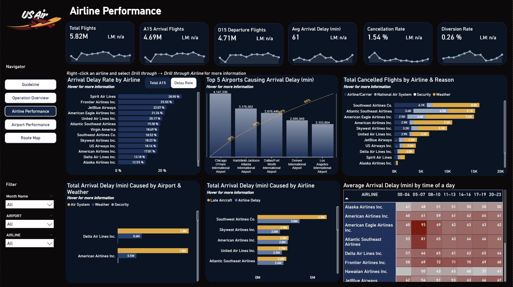
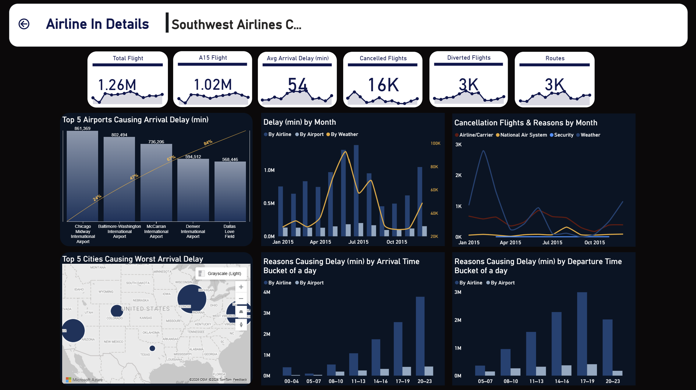
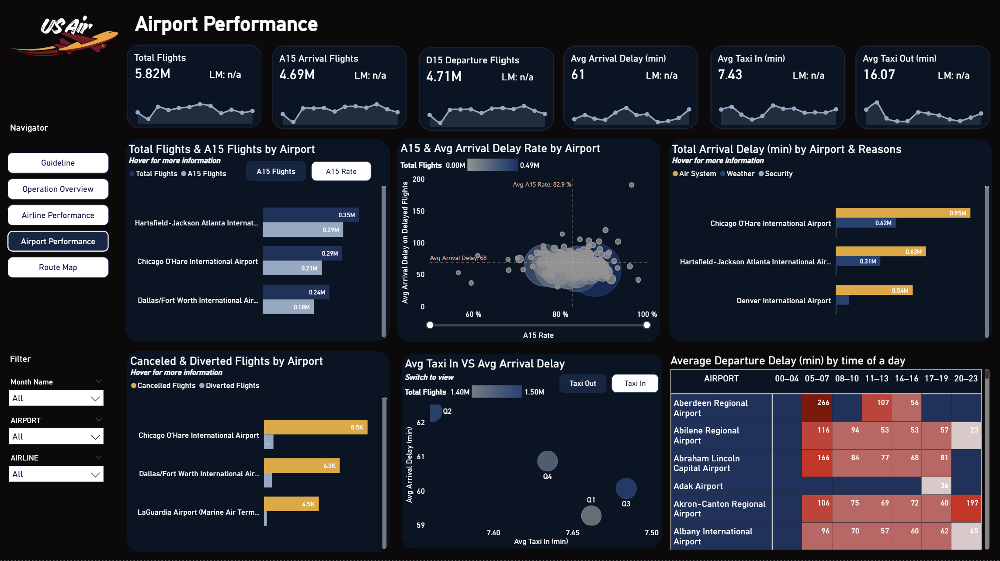
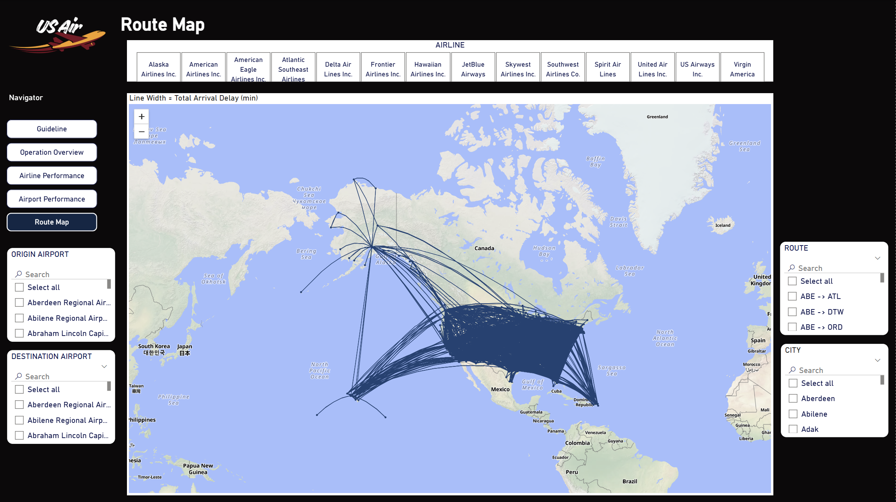
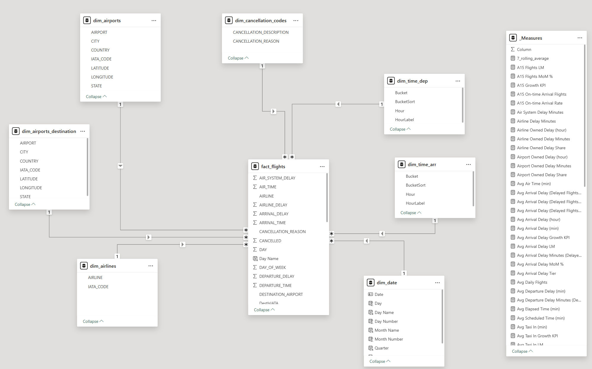

# Airline Delay and Cancellation Analysis

A Power BI project on 5.8 million US domestic flights in 2015. It looks at where delays and cancellations come from, when they concentrate, and which airlines and airports drive them, then turns the findings into recommendations for airline operations.

- 📅 **Created:** November 2026

## Table of Contents

1. 📌 [Overview](#-overview)
2. 📖 [How to Read the Dashboard](#-how-to-read-the-dashboard)
3. 🔎 [Key Insights and Recommendations](#-key-insights-and-recommendations)
4. 🔧 [Analysis Process](#-analysis-process)
5. 🚧 [Limitations](#-limitations)

## 📌 Overview

### 🎯 Business problem

A delayed or cancelled flight costs an airline in three places at once: crew and aircraft time, passenger compensation and rebooking, and customer trust. Operations teams need to know not just how many flights are late, but why, when, and where, so they can decide what to fix first.

### ❓ Business questions

1. What causes delays, and how much of that is within the airline's control?
2. When do delays and cancellations concentrate during the year?
3. Which airlines are the most and least reliable?
4. Which airports drive the most delay?

### 👤 Target audience

- **Airline operations control:** managing disruption day to day
- **Network and schedule planning:** deciding buffers, rotations and timetables
- **Customer experience:** setting expectations and handling disruption

## 📖 How to Read the Dashboard

These terms are used throughout the dashboard and this README.

### ⏱️ On-time and delayed

| Term | Meaning |
|---|---|
| **A15 (on-time arrival)** | A flight that arrives no more than 15 minutes after its scheduled time. |
| **D15 (on-time departure)** | A flight that leaves no more than 15 minutes after its scheduled time. |
| **Delayed flight** | A flight that arrives more than 15 minutes late. Anything inside the 15-minute margin counts as on time. |
| **Delay rate** | Share of completed flights that arrived more than 15 minutes late. |
| **Avg Delay of Late Flights (min)** | Average arrival delay of delayed flights only. It does not include on-time flights, so it describes how bad a late flight is, not how late the average flight is. |

### 🚫 Other flight outcomes

| Term | Meaning |
|---|---|
| **Cancellation rate** | Cancelled flights as a share of all scheduled flights. |
| **Diversion rate** | Flights sent to a different airport than planned, as a share of all scheduled flights. A diverted flight has no normal arrival, so it is not counted as on time. |
| **Taxi out / taxi in** | Minutes spent moving on the ground before take-off and after landing. |

### 🌦️ Delay causes

The dataset attributes delay minutes to five causes. The dashboard groups them by who can act on them.

| Cause | Meaning | Grouped as |
|---|---|---|
| **Airline delay** | Within the airline's control, for example crew, maintenance, baggage, fuelling. | Airline-owned |
| **Late aircraft delay** | The aircraft arrived late from its previous flight. | Airline-owned |
| **Air system delay** | Air traffic control, airport operations, heavy traffic. | Airport-owned |
| **Security delay** | Evacuations, screening problems, long security queues. | Airport-owned |
| **Weather delay** | Extreme weather at departure, en route or arrival. | Weather |

### 📅 Month comparison (LM and MoM)

The scorecards show **LM** (last month's value) and a growth arrow (month over month change). They only work when one month is selected.

The same guide is on the first page of the dashboard.

## 🔎 Key Insights and Recommendations

The questions, insights and recommendations below follow one chain: each insight answers a question, and each recommendation acts on an insight. Every figure comes from the dashboard.

| Question | Insight | Recommendation |
|---|---|---|
| 1. What causes delays, and who controls them? | Insight 1 | R1, R3 |
| 2. When do delays and cancellations concentrate? | Insights 2 and 3 | R1, R2 |
| 3. Which airlines are the most and least reliable? | Insight 4 | R4 |
| 4. Which airports drive the most delay? | Insight 5 | R5 |

Insights 1 to 3 come from the Overview page.

### 1️⃣ Insight 1: Most delay comes from causes the airline controls, mainly late incoming aircraft

Across the year, airline-owned delay (airline delay plus late aircraft delay) is 72% of arrival delay minutes, airport-owned delay (air system plus security) is 23%, and weather is 5%. Inside the airline-owned part, late aircraft delay is as large as or larger than airline delay for the five airlines with the most delay minutes. Southwest has 6.3M late aircraft minutes against 3.8M airline minutes.

*Why it matters:* this answers Question 1. Most delay is within the airline's reach. Late aircraft delay is a knock-on effect: one late flight makes the next flight on the same aircraft late, so the delay is created early and then travels through the day.

### 2️⃣ Insight 2: Delay minutes peak in mid-year and are lowest in autumn

Total arrival delay is highest around June and lowest in September and October. In the By Airline view, late aircraft delay is the larger of the two airline-owned causes through the peak, and both fall to a similar low in autumn.

*Why it matters:* the mid-year peak is driven mainly by delays carried over from earlier flights, not by one-off events, which points to schedule pressure in busy months. This links back to Insight 1.

### 3️⃣ Insight 3: Weather is the largest cause of cancellations

Of the cancellations on the dashboard, weather accounts for 48.85K, airline or carrier causes for 25.26K, and the national air system for 15.75K. Security is 0.02K. The cancellation rate trend on the Overview page peaks early in the year.

*Why it matters:* cancellations are mostly about conditions, while delays are mostly about knock-on effects. They need different plans: contingency planning for the first, buffer and recovery planning for the second.

### 4️⃣ Insight 4: Some airlines are late far more often than others

Alaska (12.55%) and Delta (13.18%) are late least often. JetBlue (22.07%), Frontier (25.50%) and Spirit (28.90%) are late most often. Spirit's flights are late more than twice as often as Alaska's. Meanwhile, average delay minutes of late flights sit in a narrower band across airlines (roughly 40 to 70 minutes on the airline scatter).

*Why it matters:* once a flight is late, it is late by a similar amount at most airlines. What separates airlines is how often it happens. A passenger feels the frequency (how many trips go wrong), so an airline can look average on delay minutes and still disrupt far more flights. Since Insight 1 shows most delay is airline-controlled, these gaps are something airlines can act on.

The drill-through page shows the same view for one airline (here Southwest), including its worst airports, delay by month and delay by time of day.

### 5️⃣ Insight 5: A few hubs account for the largest airport-side delay

Chicago O'Hare leads on arrival delay minutes at 4.15M, followed by Atlanta (3.18M), Dallas/Fort Worth, Denver and Los Angeles. At O'Hare, air system delay (0.95M) is more than double weather delay (0.42M). Atlanta shows the same pattern (0.63M against 0.31M), and air system delay is the main cause at Denver (0.54M).

*Why it matters:* two things point to congestion and airport operations, not weather or volume alone. First, air system delay is the main cause at these hubs, ahead of weather. Second, O'Hare handles fewer flights than Atlanta (0.29M against 0.35M) but has more delay minutes, so more traffic is not the whole story. O'Hare also has the most cancellations of any airport (8.5K). These airports need a different fix from an airline-wide schedule change.

The Route Map page draws every route, with line width set by total arrival delay.

### ✅ Recommendations

| # | Recommendation | Reasoning |
|---|---|---|
| **R1** | Add schedule buffer to aircraft rotations in the busiest months (around June) and to the later flights of the day, and review the aircraft with the most knock-on delay first. | Late aircraft delay is the biggest airline-owned cause (Insight 1) and is highest in the busy mid-year months (Insight 2). A buffer stops one late flight from delaying the next. |
| **R2** | Before winter, agree rebooking, crew and aircraft repositioning plans for the airports with the most cancellations (O'Hare, Dallas/Fort Worth, LaGuardia). | Weather is the largest cancellation cause (Insight 3) and cannot be removed. A plan agreed in advance shortens recovery time and reduces the number of stranded passengers. |
| **R3** | Report airline-owned and airport-owned delay minutes as two separate KPIs in the regular operations review. Give the airline-owned one to internal teams (planning, crew, maintenance) with a target, and raise the airport-owned one in meetings with airports and air traffic control. | Airline-owned delay is more than double airport-owned delay (Insight 1), so internal action has the biggest effect. Airport-owned delay is still large at the hubs (Insight 5), and the airline cannot fix it alone. |
| **R4** | Use delay rate (share of flights more than 15 minutes late) as the main reliability KPI when comparing airlines or routes, and review the airlines well above the group (JetBlue, Frontier, Spirit) against the best performers (Alaska, Delta). | Average delay minutes look similar across airlines, so they hide the gap. Delay rate shows it and matches what passengers experience (Insight 4). |
| **R5** | At O'Hare, Atlanta and Denver, review peak-hour schedules for congestion and take air system delay to the airport and air traffic control as a shared problem. | Air system delay is the main cause at these hubs (Insight 5), and a schedule review is the lever the airline controls. Buffers (R1) alone will not remove congestion. |

## 🔧 Analysis Process

### 📂 Dataset

Four files from the Kaggle dataset (originally from the US Department of Transportation):

- **Flights:** about 5.8 million flight records for 2015 with schedules, actual times, delays, delay causes, cancellations and diversions
- **Airlines:** airline codes and names
- **Airports:** airport codes, names, cities and coordinates
- **Cancellation codes:** the four cancellation reasons

### 🧹 Data preparation

Done in Power Query:

- Cleaned the flight data and converted scheduled times into usable times and hours
- Flagged rows where the airport code is a valid three-letter code
- Cleaned the airline, airport and cancellation tables
- Built a date table and two time-of-day tables that group hours into seven buckets (00-04, 05-07, 08-10, 11-13, 14-16, 17-19, 20-23)
- Used the airport table twice, once for origin and once for destination, so the route map can link both ends

### 🧩 Data model

A star schema: one flights fact table connected to the airline, origin airport, destination airport, cancellation code, date, and departure and arrival time tables. Each link is one-to-many from the dimension to the flights.

## 🚧 Limitations

- **October airports are missing from airport views.** In the source data, October flights use numeric airport IDs instead of three-letter airport codes, so they cannot be matched to the airport table. This is about 8% of the year (486,165 flights). October is included in airline-level and network-level figures, but not in airport pages, the airport filter or the route map. The airport figures in this project describe the other eleven months.
- **One year only.** The data covers 2015, so the patterns are not a trend and may not hold today.
